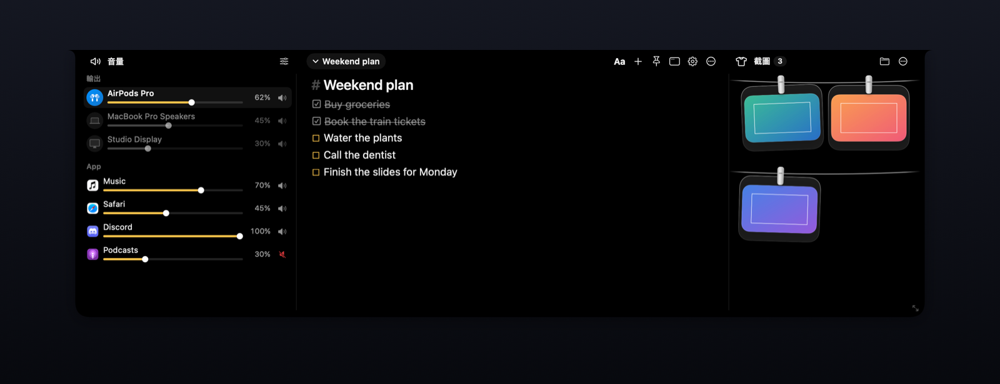
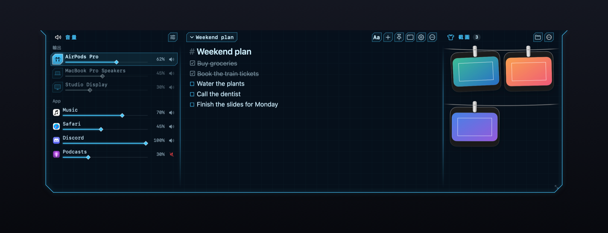
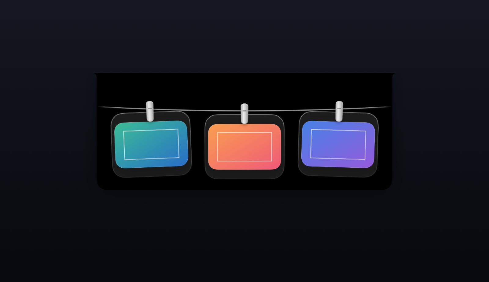
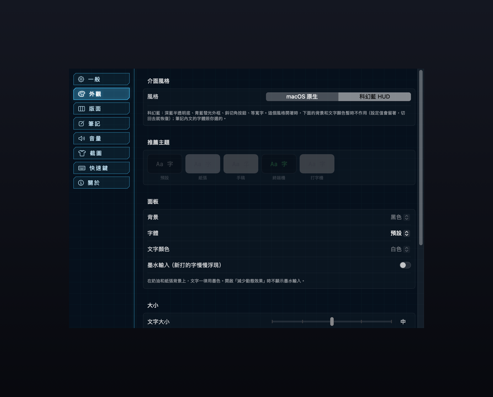
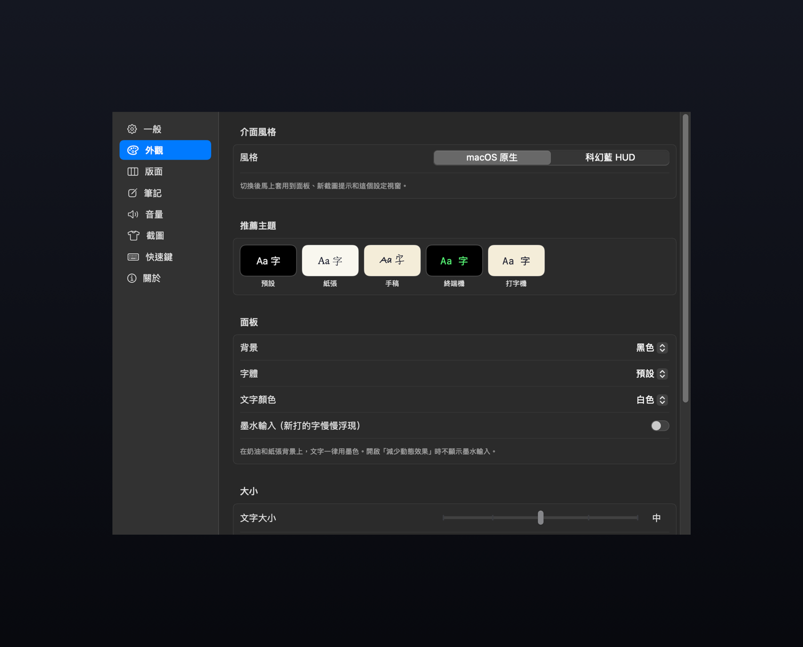

# Noted

**English** ｜ [繁體中文](#繁體中文)

A three-in-one panel for the Mac notch: **volume** (left) ｜ **notes** (middle) ｜ **screenshots** (right). On a MacBook with a notch the panel unfolds from the notch; on displays without one it is a small capsule you can drag around.



Two looks, switchable in Settings → Appearance: native macOS, or a sci-fi blue HUD.



- **Notes** – quick notes and tasks, kept in one local JSON file. Export to Markdown, daily backups.
- **Screenshots** – based on [ShotLine](https://github.com/olilllioli287/ShotLine) (MIT). New screenshots hang on the right side of the panel: click to mark up, double-click to trash, long-press to copy, drag them into other apps. Hung screenshots are put away automatically after 10 minutes.
- **Volume** – based on [FineTune](https://github.com/ronitsingh10/FineTune) (GPL-3.0). Per-app volume, EQ and output routing, plus single-choice output device switching, per-device remembered volume, and "no sound from unselected outputs". Calling apps (Discord, Zoom, Teams, …) are left alone so joining a call does not crackle.

Right after you take a screenshot, it pops out under the notch:







## Requirements

- macOS 15.4 or later
- A Swift 6.2 toolchain (Xcode with Swift 6.2; FineTune needs Swift macros)

## Build

```bash
./build.sh                  # build, install to ~/Applications/Noted.app, relaunch
./build.sh --no-open        # install without relaunching
./build.sh --out <folder>   # build <folder>/Noted.app only: no kill, no install, no launch
./build.sh --dev            # test build: build/Noted Dev.app (bundle id ends in .suite-dev)
swift test                  # unit tests
```

**Signing.** `build.sh` signs with the identity named by `NOTED_SIGN_ID` (it stops with an error if that identity does not exist). If the variable is not set and the author's local certificate is not found, it falls back to **ad-hoc** signing (`NOTED_SIGN_ID=-` asks for ad-hoc explicitly). With ad-hoc signing macOS treats every rebuild as a new app, so you have to grant the permissions below again after each build. A self-made code-signing certificate in your keychain avoids that: `NOTED_SIGN_ID="My Certificate" ./build.sh`.

**Bundle id.** The default is `com.local.noted`. If you build your own copy you can change it in `build.sh` (and `Info.plist`) to avoid clashing with other builds.

## Permissions

- **Screen & system audio recording** – per-app volume uses Core Audio process taps; screenshots watch the screenshot folder.
- **Accessibility** – optional. Used so that after dropping a screenshot into another app's text field, you can keep typing without clicking.
- **Notifications** – reminders.
- **Bluetooth** – connecting paired audio devices from the panel.

## Notes on running next to the standalone apps

While the standalone ShotLine or FineTune is running, the matching column in Noted stays in standby and does not start its own background service (two ShotLines would fight over the same screenshot; two FineTunes would play the sound twice). Noted takes over when the standalone app quits.

## Testing

A test build (`./build.sh --dev`) uses its own bundle id and temporary folders. Environment variables such as `NOTED_DATA_DIR`, `NOTED_SHOT_TEST_DIR`, `NOTED_AUDIO_DRYRUN`, `NOTED_TEST_OFFSCREEN`, `NOTED_DEMO_AUDIO` (fake devices in the volume column, for promo screenshots) and the `debug.sh` command channel only work in a build whose bundle id ends in `.suite-dev`; the normal build ignores them.

```bash
open -g -n "build/Noted Dev.app" --env NOTED_DATA_DIR=/tmp/x/data --env NOTED_SHOT_TEST_DIR=/tmp/x/shots \
  --env NOTED_AUDIO_DRYRUN=1 --env NOTED_TEST_OFFSCREEN=1
NOTED_BUNDLE_ID=com.local.noted.suite-dev ./debug.sh expand
```

## License and credits

Noted is licensed under the **GNU General Public License v3.0** (see [LICENSE](LICENSE)). It contains GPL-3.0 code from FineTune, so the whole app is a derivative work: if you distribute a binary you must also provide the complete source under GPL-3.0. See [NOTICE](NOTICE) for copyright notices and the statement of modifications.

- FineTune – © 2026 Ronit Singh, GPL-3.0 (`Sources/FineTuneKit/`, modified)
- ShotLine – © 2026 Alejandro Buján, MIT (`Sources/ShotLineKit/`)
- KeyboardShortcuts – © Sindre Sorhus, MIT (Swift package)

The UI is in Traditional Chinese; screenshot strings also have an English table (`Resources/ShotLine/`).

---

<a id="繁體中文"></a>

# Noted（繁體中文）

[English](#noted) ｜ **繁體中文**

瀏海面板三合一：**音量**（左）｜**筆記**（中）｜**截圖**（右）。有瀏海的 MacBook 從瀏海展開，沒有瀏海的螢幕用一顆可以拖的膠囊。

- **筆記**：快速記事與任務，存成一個本機 JSON 檔，可匯出 Markdown，每天自動備份。
- **截圖**：改自 [ShotLine](https://github.com/olilllioli287/ShotLine)（MIT）。新截圖掛在面板右側：單擊 Markup、雙擊丟垃圾桶、長按拷貝、拖出去給別的 App。掛著的截圖 10 分鐘後自動收起。
- **音量**：改自 [FineTune](https://github.com/ronitsingh10/FineTune)（GPL-3.0）。每個 App 各自的音量、EQ、輸出路由，加上輸出裝置單選切換、各裝置各自記住音量、沒選到的輸出裝置不外放。通話類 App（Discord、Zoom、Teams 等）不經過 Noted，進語音不會爆音。


兩種外觀，在「設定 → 外觀」切換：macOS 原生，或科幻藍 HUD。


剛截完圖，縮圖會從瀏海下方冒出來：


## 系統需求

- macOS 15.4 以上
- Swift 6.2 工具鏈（含 Swift 6.2 的 Xcode；FineTune 用到 Swift 巨集）

## 建置

```bash
./build.sh                  # 編譯、安裝到 ~/Applications/Noted.app、重開
./build.sh --no-open        # 安裝但不重開
./build.sh --out <資料夾>    # 只建到 <資料夾>/Noted.app：不結束正在跑的 Noted、不安裝、不開 App
./build.sh --dev            # 測試版 build/Noted Dev.app（bundle id 結尾是 .suite-dev）
swift test                  # 單元測試
```

**簽章**：`build.sh` 用環境變數 `NOTED_SIGN_ID` 指定的憑證簽章（找不到會報錯中止）；沒設而且找不到作者本機的憑證時，改用 **ad-hoc** 簽章（`NOTED_SIGN_ID=-` 可明確指定 ad-hoc）。ad-hoc 簽章下，macOS 把每次重建都當成新的 App，要重新授權下列權限。在鑰匙圈建立自己的程式碼簽章憑證可以避免：`NOTED_SIGN_ID="我的憑證" ./build.sh`。

**Bundle id**：預設 `com.local.noted`。自己建置時可以在 `build.sh` 與 `Info.plist` 改掉，避免跟別的版本衝突。

## 需要的權限

- **螢幕與系統錄音**：每個 App 的音量用 Core Audio process tap；截圖要監看截圖資料夾。
- **輔助使用**：選用。把截圖拖進別的 App 的文字框放開後，不用再點一下就能直接打字。
- **通知**：提醒。
- **藍牙**：從面板連接已配對的音訊裝置。

## 跟獨立版 ShotLine、FineTune 並存

獨立版還在跑的時候，Noted 裡對應的那一欄是「待命」，不會啟動自己的背景服務（兩個 ShotLine 會搶同一張截圖，兩個 FineTune 會把聲音播兩次）。獨立版結束後自動接手。

## 測試

測試版（`./build.sh --dev`）用自己的 bundle id 和暫存資料夾。`NOTED_DATA_DIR`、`NOTED_SHOT_TEST_DIR`、`NOTED_AUDIO_DRYRUN`、`NOTED_TEST_OFFSCREEN`、`NOTED_DEMO_AUDIO`（音量欄改顯示假裝置，拍宣傳圖用）這些環境變數和 `debug.sh` 指令通道，只在 bundle id 結尾是 `.suite-dev` 的版本才有作用，一般版本一律忽略。

## 授權與來源

Noted 以 **GNU General Public License v3.0** 授權（見 [LICENSE](LICENSE)）。它含有 FineTune 的 GPL-3.0 程式碼，整個 App 因此是 GPL-3.0 的衍生作品：要散布執行檔，就得一併以 GPL-3.0 提供完整原始碼。版權聲明與修改聲明見 [NOTICE](NOTICE)。

- FineTune：© 2026 Ronit Singh，GPL-3.0（`Sources/FineTuneKit/`，有修改）
- ShotLine：© 2026 Alejandro Buján，MIT（`Sources/ShotLineKit/`）
- KeyboardShortcuts：© Sindre Sorhus，MIT（Swift 套件）
